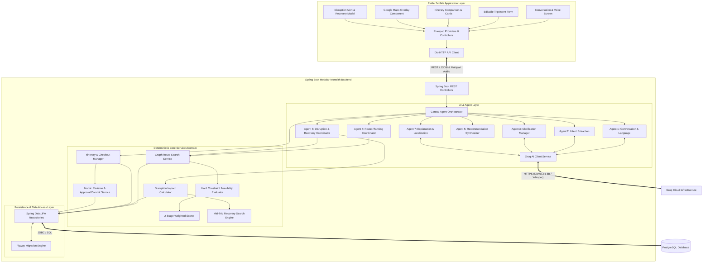
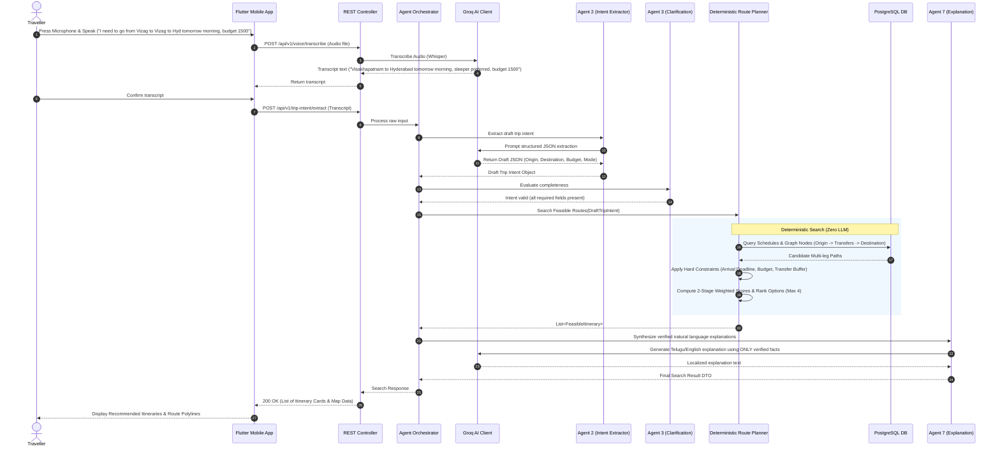
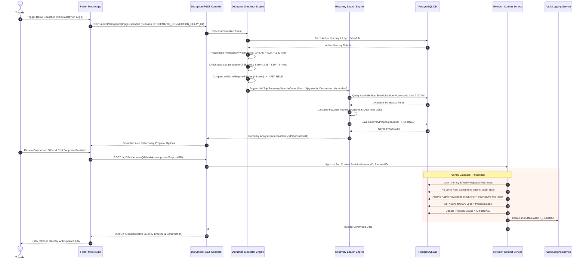
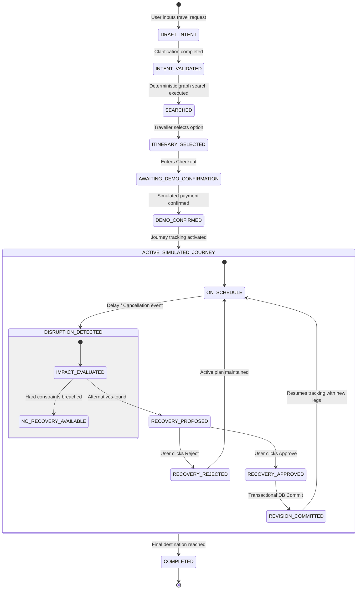

# RoamAgent Technical Architecture Diagrams

## 1. System Component Architecture Diagram

---

## 2. End-to-End Sequence Diagram: Voice Intake to Itinerary Recommendation

---

## 3. Disruption Detection, Recovery & Atomic Revision Sequence Diagram

---

## 4. Itinerary Revision & Proposal State Machine Diagram

